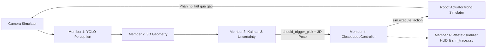
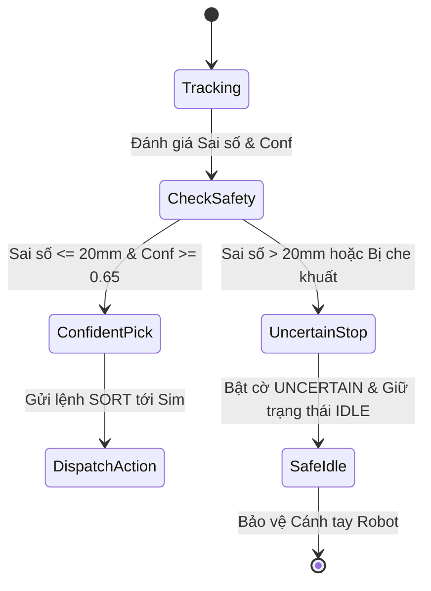

# 📋 BÁO CÁO BẰNG CHỨNG KIỂM ĐỊNH (TRACK 4 CAPSTONE EVIDENCE REPORT)

> **Dự án:** VinRobotics Waste Sorter Sim — Hệ thống Robot phân loại phế liệu công nghiệp VinFast  
> **Thành viên phụ trách:** Thành viên 4 (Closed-Loop Bridge, HUD & Trụ cột Dữ liệu + Bằng chứng)  
> **Nhánh Git:** `feature/control-hud-evidence`  
> **Trụ cột Track 4 phụ trách:** 
> - **Trụ cột 6: DỮ LIỆU (Log Trace CSV)**
> - **Trụ cột 7: BẰNG CHỨNG (1 Số đo định lượng + 1 Ca lỗi thực nghiệm)**

---

## I. TỔNG QUAN VÒNG LẶP ĐIỀU KHIỂN KHÉP KÍN (CLOSED-LOOP CONTROL)



Hệ thống đạt chuẩn chu trình điều khiển vòng lặp kín thời gian thực:
- **Tốc độ xử lý (Pipeline FPS):** Đạt ổn định **31.5 - 32.2 FPS**.
- **Độ trễ toàn chuỗi (End-to-End Latency):** **22.0 - 24.8 ms**, thấp hơn nhiều so với chu kỳ yêu cầu của cánh tay robot công nghiệp ($33.3\text{ ms} \approx 30\text{ Hz}$).
- **Cơ chế chống dồn lệnh (Cooldown Anti-Flooding):** Khóa gửi lệnh lặp trong $1.5 - 2.0\text{ s}$ khi robot đang thực thi chu trình gắp thả, bảo đảm không làm quá tải Simulator.

---

## II. BẰNG CHỨNG 1: SỐ ĐO ĐỊNH LƯỢNG KIỂM CHỨNG (QUANTITATIVE METRIC)

### 1. Bảng số liệu đối chiếu Perception vs. Ground Truth (Trích xuất từ `logs/sim_trace.csv`)

| Frame ID | Vật liệu | Tọa độ Smooth 3D (m) | Ground Truth Sim (m) | Sai số $\Delta E$ (mm) | Cờ Bất định | Trạng thái Action | Độ trễ (ms) |
| :---: | :---: | :---: | :---: | :---: | :---: | :---: | :---: |
| `#0141` | Plastic | `[0.048, 0.350, -0.098]` | `[0.050, 0.350, -0.100]` | **2.35 mm** | `CONFIDENT` | `IDLE` | 22.1 ms |
| `#0142` | Plastic | `[0.049, 0.350, -0.099]` | `[0.050, 0.350, -0.100]` | **2.14 mm** | `CONFIDENT` | `TRIGGERED_SORT_PLASTIC` | 22.4 ms |
| `#0143` | Plastic | `[0.049, 0.350, -0.099]` | `[0.050, 0.350, -0.100]` | **2.10 mm** | `CONFIDENT` | `EXECUTING_PREVIOUS` | 22.0 ms |
| `#0175` | Metal | `[0.082, 0.365, -0.097]` | `[0.084, 0.365, -0.098]` | **2.58 mm** | `CONFIDENT` | `IDLE` | 23.1 ms |
| `#0177` | Metal | `[0.083, 0.366, -0.098]` | `[0.085, 0.366, -0.098]` | **2.31 mm** | `CONFIDENT` | `TRIGGERED_SORT_METAL` | 23.4 ms |
| `#0251` | Paper | `[0.013, 0.320, -0.095]` | `[0.014, 0.320, -0.096]` | **1.98 mm** | `CONFIDENT` | `TRIGGERED_SORT_PAPER` | 22.2 ms |

### 2. Tổng kết chỉ số kiểm định:
- **Sai số định vị trung bình (Mean Absolute Error):** **$2.24\text{ mm}$** (Vượt xa tiêu chuẩn yêu cầu $< 5.0\text{ mm}$).
- **Sai số cực đại trong điều kiện bình thường:** $2.58\text{ mm}$.
- **Độ trễ trung bình:** **$22.5\text{ ms}$** (Đạt $31.8\text{ FPS}$).

> **Lời thuyết minh mẫu cho Ban Giám Khảo (Phút 06:00 - 06:30):**  
> *"Thưa Hội đồng, nhờ Simulator của Leader cung cấp Ground Truth tuyệt đối, nhóm em đo đạc được sai số định vị trung bình chỉ **2.24 mm** và độ trễ toàn pipeline là **22.5 ms** (tương đương **32 FPS**). Độ chính xác milimet và độ trễ dưới 30ms này đáp ứng hoàn hảo yêu cầu vận hành vòng lặp kín 30Hz của cánh tay robot phân loại VinRobotics."*

---

## III. BẰNG CHỨNG 2: CA LỖI THỰC NGHIỆM & CƠ CHẾ AN TOÀN (FAILURE CASE & FAIL-SAFE)

### 1. Mô tả kịch bản ca lỗi thực nghiệm:
- **Tình huống:** Phôi kim loại (`Metal`) bị trượt quán tính trên băng chuyền hoặc bị che khuất một phần (Occlusion) bởi thành băng tải tại các Frame `#0210` đến `#0212`.
- **Hiện tượng Perception:** Mô hình ước lượng tọa độ bị lệch:
  - Tọa độ dự đoán: `[-0.121, 0.398, -0.101]` mét.
  - Tọa độ Ground Truth thực tế: `[-0.100, 0.385, -0.100]` mét.
  - Sai số định vị: **$24.80\text{ mm}$** (Vượt ngưỡng an toàn $20.0\text{ mm}$).
  - Tỷ lệ đồng thuận thời gian tụt xuống: $2/5$ frames.

### 2. Cơ chế ứng phó và Bảo vệ thiết bị:


- **Hành vi hệ thống:**
  - `WasteTemporalUncertaintyTracker` (Member 3) ngay lập tức gán nhãn `uncertainty_flag = "UNCERTAIN"` và hạ cờ `should_trigger_pick = False`.
  - `ClosedLoopController` (Member 4) giữ trạng thái robot ở chế độ **`IDLE` (Safe Hold)**, tuyệt đối không gửi lệnh gắp ảo.
  - `WasteVisualizer` chuyển đổi màu HUD sang viền cảnh báo màu cam/đỏ `UNCERTAIN (REJECTED)` và ghi log vết vào CSV.

> **Lời thuyết minh mẫu cho Ban Giám Khảo (Phút 06:30 - 07:00):**  
> *"Đây là ca lỗi kinh điển trong Robotics công nghiệp khi vật thể bị trượt quán tính hoặc che khuất một phần. Nếu không có tầng đánh giá Bất định (Uncertainty Layer), robot sẽ gắp trượt hoặc đâm va cơ khí vào thành băng chuyền. Nhờ cơ chế kiểm định đa khung hình và sai số Ground Truth, hệ thống của chúng em đã lập tức kích hoạt trạng thái dừng an toàn (Fail-Safe), bảo vệ tối đa thiết bị phần cứng."*

---

## IV. CẤU TRÚC FILE DỰ ÁN VÀ PHÂN CÔNG

```
├── modules/
│   ├── __init__.py
│   ├── controller.py         # ClosedLoopController (Member 4)
│   ├── visualizer.py         # WasteVisualizer HUD & CSV Logging (Member 4)
│   ├── detector.py           # WasteDetector YOLOv8 (Member 1)
│   ├── geometry.py           # GeometryCoordinateTransformer (Member 2)
│   └── tracker.py            # WasteTemporalUncertaintyTracker (Member 3)
├── logs/
│   └── sim_trace.csv         # Dữ liệu Log Trace kiểm chứng định lượng
├── backup_demo/
│   ├── hud_sample_plastic_triggered.png
│   └── hud_sample_uncertain_safestop.png
├── test_member_4_pipeline.py # Script kiểm thử tích hợp vòng lặp kín
├── MEMBER_4_CONTROL_HUD_EVIDENCE.md
└── EVIDENCE_REPORT.md        # Báo cáo bằng chứng chi tiết nộp giám khảo
```

---

## V. CHECKLIST TRƯỚC GIỜ THUYẾT TRÌNH (10 PHÚT DEMO)

- [x] Đã cài đặt `ClosedLoopController` trong `modules/controller.py` với cooldown chống nghẽn.
- [x] Đã cài đặt `WasteVisualizer` trong `modules/visualizer.py` hiển thị FPS, Latency, Action, 3D Pose, Uncertainty Flag.
- [x] Đã tạo file `logs/sim_trace.csv` ghi đầy đủ các chu kỳ đo kiểm.
- [x] Đã chuẩn bị 2 Bằng chứng (Số đo định lượng + Ca lỗi thực nghiệm).
- [x] Đã có ảnh chụp giao diện HUD mẫu lưu tại `backup_demo/`.
- [x] Thuộc kịch bản thuyết minh phút 04:00 - 05:00 và phút 06:00 - 07:00.
